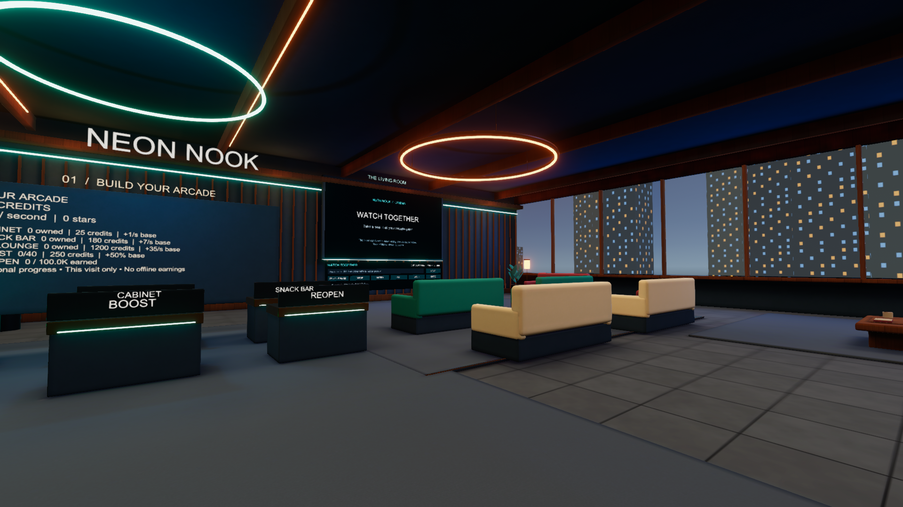
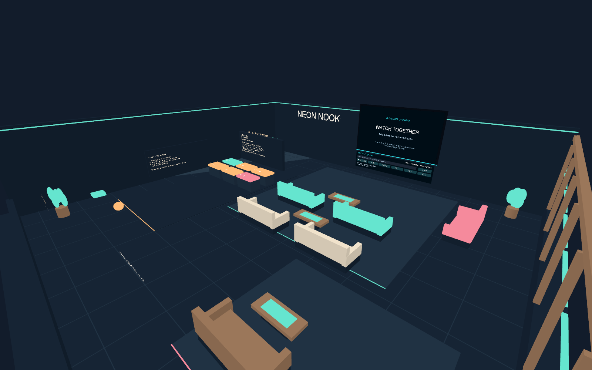

# Neon Nook

A spacious VRChat arcade lounge inspired by AdVenture Capitalist's buy / earn / reinvest loop. Selected furniture from the supplied Gaming Room package is reused in an original 24 x 22 metre hangout.

## Open

1. Install Unity **2022.3.22f1** with Android build support through VRChat Creator Companion.
2. Add this existing project to Creator Companion and restore pinned VRChat Worlds/Base **3.10.6** packages. Alternatively run `./Setup-Project.ps1` in PowerShell.
3. Choose the scene for the target platform, then Play for ClientSim:
   - **PC:** `Assets/IdleLounge/Scenes/NeonNook-PC.unity` — enhanced materials, geometry, lighting and post-processing.
   - **Quest / Android:** `Assets/IdleLounge/Scenes/NeonNook.unity` — the original lighter version.
4. **Neon Nook > Build preview world** regenerates the original scene. `NeonNookPcUpgrade.Build` copies that scene to the PC scene, then runs the PC lighting bake, audit and preview rendering. **Rebuilding overwrites the generated PC scene.** Keep manual edits in a separate scene copy before running either generator.

`NeonNookPcUpgrade.Open` opens the PC scene without rebuilding it. The PC scene is cloned from the original so its network objects are preserved across the two platform versions. Gameplay remains the same.

Versions match official VRChat requirements checked November 1, 2026. Do not independently upgrade this project to Unity 6.

## Features

- Personal idle arcade: automatic income, tapping, three businesses, efficiency boosts, and confirmed reopen/prestige at 100K earned.
- Separate wallets per visitor. **Current visit only**: no persistent saving or offline earnings.
- Twelve VRChat seats, broad walking routes, a quiet corner and skyline outlook.
- Shared host-controlled video; personal volume, mute and retry. No automatic external media playback. Direct HTTPS MP4 is the most predictable test source; codec, URL permissions and platform support affect playback.
- One synchronized pickup ball and a return button that ignores a held ball.
- Quest version: lightweight opaque shaders with no realtime lights, mirrors or post-processing.
- PC version: Standard PBR materials with procedural tile maps, beveled geometry, baked lightmaps and probes, restrained bloom and ACES tonemapping, plus the supplied Gaming Room desk.
- Both versions use a 1024 x 576 video render target.

## VRChat testing and upload

Sign into the SDK, open `NeonNook-PC.unity`, run Builder checks, and Build & Test on Windows. For cross-platform publication, upload that scene for Windows first. Then switch to Android, open the original `NeonNook.unity`, and upload with the **same blueprint ID**. Both scene descriptors must point to that same world; do not create a second world for Quest. There is no assigned world ID or account credential in this project.

Before publishing, use an actual PC + Quest session to test independent wallets, seating exits, video late joins, host departure, ball ownership transfers, and local volume. Measure headset performance with avatars present. Desktop renders and Android compilation cannot establish headset frame rate or networking behavior.

## Source assets

`Assets/Gaming Room` preserves user-supplied meshes, textures and source materials. Its readme is a folder guide; no general redistribution license was found. Keep source private and verify the creator's terms before redistributing assets or publishing. Bundled lilToon scripts/shaders and baked lighting were excluded. Used materials are converted for the target scene: lightweight lounge materials on Quest and Standard PBR materials on PC.

Code and generated scene: `Assets/IdleLounge`. SDK packages restore from official URLs; Unity caches and builds are ignored.

See `VALIDATION.md` for completed checks and remaining hardware tests.

- [Supported Unity version](https://creators.vrchat.com/sdk/upgrade/current-unity-version/)
- [Video players](https://creators.vrchat.com/worlds/udon/video-players/)
- [Android limitations](https://creators.vrchat.com/platforms/android/quest-content-limitations/)

## Preview images and developer checks

PC entry preview, generated by the PC rebuild:

Original lighter scene:

Generated previews and bundles default to the ignored `Builds` folder. Set `NEON_NOOK_OUTPUT_DIR` to choose another output folder. Editor menu actions rebuild or validate the scene.

- `NeonNookPcUpgrade.Build` copies the original scene into the PC scene, applies the PC treatment, then bakes, audits and renders it. Run this before platform exports, preserving any manual edits in a separate copy.
- `NeonNookPcUpgrade.Open` opens the generated PC scene.
- `WorldBuildChecks.WindowsPC` exports the actual PC scene as a VRChat Windows bundle without uploading.
- `WorldBuildChecks.Android` exports the original lighter scene as a VRChat Android bundle without uploading.
- `ArcadeEconomyChecks.Run` checks purchase and prestige rules.
- `RuntimeSmoke.Begin` runs real Udon events under ClientSim (batch mode, without `-quit`, and exits automatically).
- `RuntimeSmoke.BeginPC` runs the same game checks in the enhanced scene and verifies the player camera inherits HDR, post-processing and baked lightmaps. It saves a direct player-camera capture.

Keep both scene versions from the same generation when exporting for publication. These commands describe the workflow; consult `VALIDATION.md` for checks actually completed. A successful export does not establish PC visual quality, Quest frame rate, video playback or multiplayer behavior.

## Optional visual references

Use the actual in-world views in these references to assess room scale, seating, lighting and atmosphere; listing thumbnails alone are not a visual target. These are references, not bundled assets:

- [MidnightRooftop — community interior views](https://vrclist.com/world/2427)
- [AfterGlow — creator interior shots](https://wispywoo.gumroad.com/l/AfterGlow)
- [Organism — in-world walkthrough](https://steamcommunity.com/sharedfiles/filedetails/?id=3471360328)
